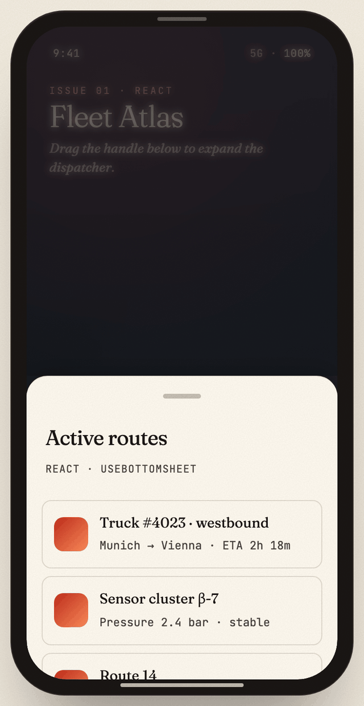
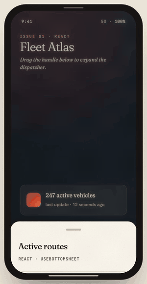

# @surdeddd/bottom-sheet

Bottom sheet, drawer and modal sheet for the web. One gesture engine with snap
points, spring physics and keyboard accessibility, and the same engine behind
adapters for **React, Vue 3, Svelte 5, Solid, Qwik, Preact** and a
`<bottom-sheet>` **custom element** that works in Angular, Lit, Astro or plain
HTML.

[](https://www.npmjs.com/package/@surdeddd/bottom-sheet)
[](https://www.npmjs.com/package/@surdeddd/bottom-sheet)


**[Live demo](https://bottom-sheet-demo-ashy.vercel.app)** ·
**[API reference](https://surdeddd.github.io/BottomSheet/)** ·
[Changelog](CHANGELOG.md) ·
[Русская версия](https://github.com/Surdeddd/BottomSheet/blob/main/README.ru.md)

<p align="center">
  <picture>
    <source media="(prefers-color-scheme: dark)" srcset="docs/screenshots/sheet-dark.png" />
    
  </picture>
  
</p>

## Why this one

- **One engine, every framework.** The component you use in React behaves
  exactly like the one in Vue, Svelte, Solid, Qwik or the custom element,
  because they are thin adapters over the same core.
- **Snap points in any unit.** Pixels, percentages, `fit` (the content's own
  height) or any CSS length such as `50dvh` or `clamp(200px, 60%, 800px)`.
- **Four edges.** `bottom`, `top`, `left`, `right`, plus `start` / `end` that
  follow the writing direction.
- **Feels native.** Spring physics with velocity carry, rubber-band over-drag,
  separate thresholds for touch and mouse, motion on the compositor only.
- **Accessible.** Keyboard slider on the handle, focus trap with restore,
  `inert` for everything behind a modal sheet, reduced motion, forced colors.
- **Knows about the phone.** Rests on top of the on-screen keyboard, respects
  safe-area insets, closes on the Back button, locks page scroll the iOS-safe
  way.
- **Stacks.** Several sheets open at once, each with its own backdrop and focus
  scope.
- **Small and tree-shakable.** 25.6 KB gzip for the full engine, 21.9 KB for the
  slim core, no runtime dependencies.

## Install

```bash
npm i @surdeddd/bottom-sheet
```

Frameworks are optional peer dependencies: you install only the one you use.

## Quick start

### A modal sheet opened by a button

```tsx
import { useState } from 'react';
import { BottomSheet } from '@surdeddd/bottom-sheet/react';
import '@surdeddd/bottom-sheet/styles';

export function Filters() {
  const [open, setOpen] = useState(false);

  return (
    <>
      <button onClick={() => setOpen(true)}>Filters</button>

      <BottomSheet
        open={open}
        onOpenChange={setOpen}
        snapPoints={[
          { id: 'closed', size: 0 },
          { id: 'open', size: 'fit' },
        ]}
        focusTrap
        header={<h2>Filters</h2>}
      >
        <FilterForm />
      </BottomSheet>
    </>
  );
}
```

`open` needs one snap point of size `0`: that is the closed state. A tap on the
backdrop, Escape and a drag down all close the sheet and report it through
`onOpenChange`.

### A sheet that stays on screen

The maps pattern: a strip at the bottom that the user pulls up.

```tsx
<BottomSheet
  snapPoints={[
    { id: 'peek', size: 96 },
    { id: 'half', size: '45dvh' },
    { id: 'full', size: '90%' },
  ]}
  initial="peek"
  header={<h2>Nearby</h2>}
>
  <PlaceList />
</BottomSheet>
```

### Other frameworks

<details>
<summary><b>Vue 3</b></summary>

```vue
<script setup lang="ts">
import { ref } from 'vue';
import { BottomSheet } from '@surdeddd/bottom-sheet/vue';
import '@surdeddd/bottom-sheet/styles';

const open = ref(false);
const points = [
  { id: 'closed', size: 0 },
  { id: 'open', size: 'fit' },
];
</script>

<template>
  <button @click="open = true">Filters</button>
  <BottomSheet v-model:open="open" :snap-points="points" focus-trap>
    <template #header><h2>Filters</h2></template>
    <FilterForm />
  </BottomSheet>
</template>
```

[Vue guide →](docs/vue.md)

</details>

<details>
<summary><b>Svelte 5</b></summary>

```svelte
<script lang="ts">
  import { BottomSheet } from '@surdeddd/bottom-sheet/svelte';
  import '@surdeddd/bottom-sheet/styles';

  let open = $state(false);
</script>

<button onclick={() => (open = true)}>Filters</button>

<BottomSheet
  bind:open
  snapPoints={[{ id: 'closed', size: 0 }, { id: 'open', size: 'fit' }]}
  focusTrap
>
  {#snippet header()}<h2>Filters</h2>{/snippet}
  {#snippet children()}<FilterForm />{/snippet}
</BottomSheet>
```

[Svelte guide →](docs/svelte.md)

</details>

<details>
<summary><b>Solid</b></summary>

```tsx
import { createSignal } from 'solid-js';
import { BottomSheet } from '@surdeddd/bottom-sheet/solid';
import '@surdeddd/bottom-sheet/styles';

export function Filters() {
  const [open, setOpen] = createSignal(false);
  return (
    <>
      <button onClick={() => setOpen(true)}>Filters</button>
      <BottomSheet
        open={open()}
        onOpenChange={setOpen}
        snapPoints={[{ id: 'closed', size: 0 }, { id: 'open', size: 'fit' }]}
        focusTrap
        header={<h2>Filters</h2>}
      >
        <FilterForm />
      </BottomSheet>
    </>
  );
}
```

[Solid guide →](docs/solid.md)

</details>

<details>
<summary><b>Qwik</b></summary>

```tsx
import { component$, useSignal } from '@builder.io/qwik';
import { BottomSheet } from '@surdeddd/bottom-sheet/qwik';
import '@surdeddd/bottom-sheet/styles';

export const Filters = component$(() => {
  const open = useSignal(false);
  return (
    <>
      <button onClick$={() => (open.value = true)}>Filters</button>
      <BottomSheet
        open={open.value}
        onOpenChange$={next => (open.value = next)}
        snapPoints={[{ id: 'closed', size: 0 }, { id: 'open', size: 'fit' }]}
        focusTrap
      >
        <h2 q:slot="header">Filters</h2>
        <FilterForm />
      </BottomSheet>
    </>
  );
});
```

[Qwik guide →](docs/qwik.md)

</details>

<details>
<summary><b>Custom element</b> (Angular, Lit, Astro, plain HTML)</summary>

```html
<script type="module">
  import '@surdeddd/bottom-sheet/element';
</script>

<button onclick="document.querySelector('bottom-sheet').open()">Filters</button>

<bottom-sheet snap-points="closed:0,open:fit" focus-trap="true">
  <h2 slot="header">Filters</h2>
  <form>…</form>
</bottom-sheet>
```

The element carries its own styles in its shadow root; no stylesheet is needed.
Without a bundler, load it from a CDN:

```html
<script src="https://unpkg.com/@surdeddd/bottom-sheet/dist/element.iife.global.js"></script>
```

[Custom element guide →](docs/web-component.md)

</details>

<details>
<summary><b>No framework</b></summary>

```html
<div class="bs-root">
  <div class="bs-backdrop"></div>
  <section class="bs-sheet" data-mode="bottom" role="dialog" aria-label="Filters">
    <div class="bs-handle" role="slider" tabindex="0" aria-label="Resize sheet"></div>
    <div class="bs-content">…</div>
  </section>
</div>
```

```ts
import { BottomSheetEngine } from '@surdeddd/bottom-sheet';
import '@surdeddd/bottom-sheet/styles';

const root = document.querySelector('.bs-root')!;
const sheet = new BottomSheetEngine({
  element: root.querySelector('.bs-sheet')!,
  handle: root.querySelector('.bs-handle')!,
  scrollContainer: root.querySelector('.bs-content')!,
  backdrop: root.querySelector('.bs-backdrop')!,
  snapPoints: [
    { id: 'closed', size: 0 },
    { id: 'open', size: 'fit' },
  ],
  initial: 'closed',
});

document.querySelector('#filters')!.addEventListener('click', () => sheet.open());
```

[Vanilla guide →](docs/vanilla.md)

</details>

Preact: `@surdeddd/bottom-sheet/preact` is the React adapter running on
`preact/compat` ([guide](docs/preact.md)). Angular, Lit and Astro use the
custom element or the engine: [Angular](docs/angular.md), [Lit](docs/lit.md),
[Astro](docs/astro.md).

## Concepts

**Snap points** are the sizes the sheet can rest at. Each has an `id` you refer
to and a `size`:

```ts
type SnapPoint =
  | number                 // pixels
  | `${number}%`           // share of the viewport along the sheet's axis
  | 'fit' | 'content'      // the sheet's own height: handle, header, content, footer
  | 'full'                 // the whole axis
  | string;                // any CSS length: "50dvh", "clamp(200px, 60%, 800px)"
```

A point of size `0` is the **closed** state. A sheet without one cannot be
closed, only collapsed to its smallest point.

**Three layers** make up a sheet: the *sheet* itself, the *backdrop* that dims
the page, and an optional *scrim* (`screen`) for content that fades in behind
the sheet, such as a map preview or a blurred overlay.

**State** is one object: `{ activeId, size, progress, phase, isDragging,
isAnimating }`. `progress` runs from 0 at the smallest allowed point to 1 at the
largest. `phase` is `closed`, `opening`, `open` or `closing`.

## API

Every option, method and event below works the same in every adapter. Component
adapters take options as props (`focus-trap` in Vue templates, `focus-trap="true"`
on the custom element).

### Options

Sizing and position

| Option | Default | What it does |
| --- | --- | --- |
| `snapPoints` | required | List of `{ id, size }` |
| `allowed` | all ids | The points the sheet may rest at right now |
| `initial` | first allowed | The point to start at. A point larger than `0` starts the sheet open, with no `open` event |
| `mode` | `"bottom"` | Edge: `bottom`, `top`, `left`, `right`, or `start` / `end` |
| `maxHeight` | none | Cap on the sheet's size: pixels, or a CSS length resolved again when the viewport changes |
| `radius` | `20px` | Corner radius |
| `fitContentToSnap` | `false` | Keep the whole scroll area and the footer reachable at every point, not only the largest. [Details](docs/content-fit.md) |

Motion

| Option | Default | What it does |
| --- | --- | --- |
| `animation` | `"spring"` | `spring`, `ios-spring`, `material-bounce`, `snappy`, `tween`, `linear` |
| `spring` | preset | `{ stiffness, damping, mass }` |
| `duration`, `easing` | `220`, ease-out-back | Length in ms and curve `(t) => number` of the `tween` animation |
| `settleAnimation` | off | `"waapi"` runs the settle as a compositor-driven Web Animation |
| `respectReducedMotion` | `true` | Jump straight to the point under `prefers-reduced-motion: reduce` |
| `viewTransitions` | `false` | Move between points through `document.startViewTransition()` where the browser has it |

Gestures

| Option | Default | What it does |
| --- | --- | --- |
| `dragFrom` | `"handle"` | Where a drag may start: the `handle`, the whole `sheet`, or `zones` (`[data-bs-drag]` subtrees only). `[data-bs-no-drag]` opts a subtree out. A sheet without a handle defaults to `sheet` |
| `dragFromContent` | `true` | Whether a touch on the scroll area drags the sheet. Can be set per point: `{ id, size, dragFromContent: false }` |
| `disableDrag` | `false` | Turn the gesture off; methods still work |
| `rubberBand` | `true` | Soft over-drag past the last point |
| `flickVelocity` | `0.65` px/ms | Speed at which a touch or pen release counts as a flick. A mouse uses a fixed 0.4 |
| `dragThreshold` | `18` px | A touch or pen drag shorter than this snaps back. A mouse uses a fixed 12 |

Closing

| Option | Default | What it does |
| --- | --- | --- |
| `closeOnEscape` | `true` | Escape closes the top sheet |
| `closeOnBack` | `false` | The Back button closes the sheet instead of leaving the page |
| `routedTo` | none | URL shown while the sheet is open; Back closes it and restores the address |
| `closeOnRouteChange` | `false` | Close when the URL changes |
| `persistent` | `false` | The user cannot dismiss the sheet: no backdrop tap, Escape, Back, drag or key closes it. `close()` still does |
| `disableClose` | `false` | Nothing closes the sheet, `close()` included |

Focus and accessibility

| Option | Default | What it does |
| --- | --- | --- |
| `focusTrap` | `false` | Move focus into the sheet when it opens, keep Tab inside it while it is the top one, and give focus back when it closes. Mark a popup rendered elsewhere with `data-bs-focus-allow` to let focus go there |
| `initialFocus` | first focusable | With `focusTrap`: the element or selector that gets focus on open. The first focusable element is the handle; `false` focuses the sheet itself |
| `returnFocusTo` | none | Element, selector or function: where to send focus on close. A focus trap already returns it to where it was |
| `inertSiblings` | `false` | Make everything outside the sheet `inert` while it is the top one |
| `lockBodyScroll` | `true` | Lock page scroll while the sheet is open |

Backdrop and scrim

| Option | Default | What it does |
| --- | --- | --- |
| `backdropRange` | `[0, 1]` | The stretch of `progress` over which the backdrop fades in |
| `backdropOpacity` | `1` | The opacity the backdrop reaches at the end of that stretch |
| `backdropColor` | `rgb(0 0 0 / 0.5)` | Colour of the backdrop; the same as the `--bs-backdrop-color` token |
| `screenRange` | `[0, 1]` | The same stretch for the scrim |
| `scrimMode` | `"full"` | `full` screen, `above-sheet` (stops at the sheet's edge) or `off` |
| `scrimPreset` | none | `subtle`, `standard`, `monitoring`, `cinematic`: colour, blur and range in one |
| `scrimColor`, `scrimBlur` | preset | Scrim fill and the radius of its `backdrop-filter` blur |
| `scrimInteractive` | `false` | The scrim takes pointer input instead of letting it through |
| `scrimTapToClose` | `false` | A tap on the scrim closes the sheet |

More

| Option | Default | What it does |
| --- | --- | --- |
| `stackEffect` | `false` | Scale the sheets behind the top one, like the iOS card stack |
| `persistKey` | none | `localStorage` key: the sheet starts where it was left |
| `autoCollapseAfter` | off | Milliseconds of rest after which the sheet returns to its smallest open point |
| `linkedSheets` | none | Other engines that collapse when this one opens |
| `features` | all | Feature list for the [slim core](#slim-core) |

Component adapters add a few props of their own:

| Prop | Default | What it does |
| --- | --- | --- |
| `open`, `onOpenChange` | uncontrolled | Controlled open state. `v-model:open` in Vue, `bind:open` in Svelte, `onOpenChange$` in Qwik, the `open` attribute on the element |
| `snap` | uncontrolled | The active snap point, as a prop: `v-model:snap` in Vue, `bind:snap` in Svelte, `snap` with `onSnap$` in Qwik, the `snap` attribute on the element. React and Solid use the ref |
| `header`, `footer` | none | Regions above and below the scroll area (slots in Vue, snippets in Svelte) |
| `backdrop` | `true` | Render the backdrop |
| `closeOnBackdrop` | `true` | A tap on the backdrop closes the sheet |
| `teleportTo` | none | Move the sheet's DOM out of a clipping or transformed ancestor |
| `ariaLabel` | `"Bottom sheet"` | Accessible name of the sheet |
| `handleLabel`, `contentLabel` | English | Accessible names of the handle and the scroll area, for apps in another language |

### Methods

```ts
sheet.open();              // closed → the first allowed open point; an open sheet stays put
sheet.open('half');        // to a specific point
sheet.close();             // → the closed point; without one, the smallest point
sheet.snapTo('full');
sheet.expand();            // → the largest allowed point
sheet.collapse();          // → the smallest allowed open point

sheet.setAllowed(['half', 'full']);        // change where it may rest
sheet.setSnapPoints(points);               // replace the points
sheet.recompute();                         // re-measure a 'fit' point
sheet.setMode('right');
sheet.setPersistent(true);
sheet.setDisableClose(true);
sheet.setDisableDrag(true);
sheet.setRadius('28px');
sheet.setMaxHeight('92dvh');
sheet.setBackdropOpacity(0.6);
sheet.setBackdropColor('rgb(0 0 0 / 0.4)');

sheet.state;               // { activeId, size, progress, phase, isDragging, isAnimating }
sheet.getResolvedSnaps();  // [{ id, size }] in pixels right now
sheet.canDismiss();        // false while persistent or disableClose
sheet.isTop();             // is it the top sheet of the stack?
sheet.destroy();
```

`open()`, `close()` and `snapTo()` return a promise that resolves when the
sheet has landed. They are safe to call in the tick the sheet is mounted.

When `setAllowed()` or `setSnapPoints()` takes the active point away, an open
sheet moves to the nearest point that keeps it open.

In components these are on the ref (`ref.current.open()`), on the element
(`el.open()`), or on the object the composable returns. Anything missing there
is one call away through `getEngine()`.

### Events

```ts
sheet.on('open', ({ id }) => {});       // the sheet starts to appear
sheet.on('opened', ({ id }) => {});     // it has landed
sheet.on('close', () => {});            // it starts to leave
sheet.on('closed', () => {});           // it is gone: unmount here
sheet.on('snap', ({ id, size, progress }) => {});   // it settled on a point

sheet.on('dragstart', ({ size }) => {});
sheet.on('drag', ({ size, delta }) => {});          // every frame
sheet.on('dragend', ({ size, velocity }) => {});
sheet.on('progress', ({ value, size }) => {});      // every frame of any motion

sheet.on('before-snap', ({ id, previousId, cancel }) => {});
sheet.on('before-close', ({ reason, cancel }) => {});
```

Call `cancel()` synchronously inside `before-snap` or `before-close` to stop
the move; `reason` is `programmatic`, `backdrop`, `escape` or `back`.

The scroll lock, the focus trap and the history entry go on at `open`. The
history entry comes off at `close`; the lock and the trap at `closed`, when
the sheet is gone. A move reversed half-way fires `open` or `close` again, so
the two always alternate.

Components expose these as `onSnap`, `onOpen`… props (React, Solid),
`@snap`, `@open`… (Vue), `onsnap`… (Svelte), `onSnap$`… (Qwik) and DOM events
on the custom element.

### The keyboard

The handle is a slider. The arrow that points away from the sheet's edge grows
it (`ArrowUp` for a bottom sheet, `ArrowLeft` for a right one), the opposite one
shrinks it, `Home` and `End` jump to the smallest and largest point, `Escape`
closes.

### More of the API

| Topic | Guide |
| --- | --- |
| Buttons and bars pinned to the sheet's edge, scrim content per state | [Anchors and scrim stages](docs/anchors.md) |
| Changing the scrim at runtime | [Theming → the scrim](docs/theming.md#the-scrim) |
| A lighter slide-up panel without snap points | [Overlay](docs/overlay.md) |
| Sheets configured per route | [Vanilla → sheet manager](docs/vanilla.md#sheet-manager) |
| Navigating right after a close with `closeOnBack` | [Vanilla → waiting for the history](docs/vanilla.md#waiting-for-the-history) |
| Moving the sheet from code, frame by frame | [Recipe: programmatic drag](docs/recipes/programmatic-drag.md) |
| Your own engine extensions | [Plugins](docs/plugins.md) |
| Right-to-left interfaces | [RTL](docs/rtl.md) |

## Styling

Everything visual is a CSS custom property. Set them on `.bs-root`, on a parent,
or on `:root`; they reach into the custom element's shadow root too.

```css
.bs-root {
  --bs-surface: #18181b;
  --bs-radius: 28px;
  --bs-handle-color: #71717a;
  --bs-backdrop-color: rgb(0 0 0 / 0.6);
}
```

The engine writes `--bs-progress` (0 to 1) and `--bs-size` (pixels) on the
sheet and on `.bs-root` on every frame, so anything inside the root, such as
the `screen` layer or a floating button, follows the sheet without JavaScript:

```css
.bs-root .map-preview { filter: blur(calc(var(--bs-progress) * 8px)); }
.bs-root .fab { bottom: calc(var(--bs-size) + 16px); }
```

Three ready-made looks ship as extra stylesheets:

```ts
import '@surdeddd/bottom-sheet/themes/ios';       // also /material, /vercel
```

```html
<div class="bs-theme-ios"><!-- the sheet --></div>
```

[All tokens, themes, stacking and the custom element's parts →](docs/theming.md)

## Accessibility

What is built in, and what you switch on:

- **The handle is a slider.** It has a label, a current value and arrow-key
  steps, and it is in the tab order. Name it in your language with
  `handleLabel`; `contentLabel` does the same for the scroll area.
- **The sheet has a name.** `ariaLabel`, or `ariaLabelledBy` pointing at a
  heading. With `focusTrap` it is a `dialog` with `aria-modal`.
- **Focus.** `focusTrap` moves focus into the sheet, keeps Tab inside it and
  returns focus to the opener on close. In a stack, only the top sheet traps.
- **The page behind.** `inertSiblings` takes everything outside the top sheet
  out of reach of the keyboard and of screen readers.
- **Announcements.** Each settle is announced through a polite live region.
- **Motion and contrast.** `prefers-reduced-motion` turns animations into
  jumps, and `forced-colors` gets a border, a visible handle and a system
  focus ring.

A modal sheet should have `focusTrap` and `inertSiblings` both on.

## Forms and the on-screen keyboard

A bottom sheet rests on top of the phone keyboard, not under it, so a field
being typed in stays visible. With `focusTrap`, focus goes to the handle when
the sheet opens, so the keyboard stays down until the user taps a field;
`initialFocus="#email"` starts in a field instead.

To stop a sheet with unsaved input from closing, veto the move:

```ts
sheet.on('before-close', ({ cancel }) => {
  if (form.isDirty) cancel();
});
```

For React Hook Form and Formik this is one line:

```ts
import { useFormGuard } from '@surdeddd/bottom-sheet/integrations/react-hook-form';

useFormGuard(sheetRef, form); // stays put while submitting, stays open while dirty
```

## Server rendering

Every adapter can be imported and rendered on the server; the engine attaches
on the client. A sheet that starts closed is hidden in the server markup, so
nothing flashes before hydration. Next.js, Nuxt, SvelteKit, SolidStart, Qwik
City and Astro work without extra setup; the per-framework guides cover the
details.

## Slim core

The default engine includes every optional behaviour. If size matters more,
start from the slim core and add the features you use:

```ts
import { BottomSheetCore } from '@surdeddd/bottom-sheet/core';
import { routeFeature, contentSwipeFeature } from '@surdeddd/bottom-sheet/features';

const sheet = new BottomSheetCore({
  element, handle, snapPoints,
  closeOnBack: true,
  features: [routeFeature(), contentSwipeFeature()],
});
```

| Entry | gzip | What is in it |
| --- | --- | --- |
| `@surdeddd/bottom-sheet` | 25.6 KB | The full engine |
| `/core` | 21.9 KB | Gestures, snap points, focus, scroll lock, scrim, stacking |
| `/features` | 4.2 KB | `routeFeature`, `visualViewportFeature`, `contentSwipeFeature`, `contentFitFeature`, `persistFeature`, `autoCollapseFeature` |
| `/react` `/vue` `/svelte` `/solid` `/qwik` | 27 to 33 KB | The full engine plus the adapter |
| `/element` | 33.3 KB | The full engine, the element and its styles |
| `/overlay` | 8.4 KB | The standalone [overlay](docs/overlay.md) |
| `/webgl` | 5.9 KB | Optional [GPU renderer](docs/webgl.md) for the sheet surface |
| `/debug` | 0.9 KB | `attachDebugOverlay(engine)`: a live panel of the engine's state |

An option whose feature is missing warns once in development and is ignored.

## Browser support

Chrome and Edge 80, Safari 13.1 (iOS 13.4), Firefox 72. That floor comes from
the ES2020 build and from the APIs the engine cannot do without: Pointer
Events, CSS custom properties, `ResizeObserver`. Everything else, from `inert`
to `backdrop-filter` to WebGL, is detected and degrades.
[Support matrix →](docs/browser-support.md)

## Documentation

| | |
| --- | --- |
| Frameworks | [React](docs/react.md) · [Vue](docs/vue.md) · [Svelte](docs/svelte.md) · [Solid](docs/solid.md) · [Qwik](docs/qwik.md) · [Preact](docs/preact.md) · [Custom element](docs/web-component.md) · [Vanilla](docs/vanilla.md) · [Angular](docs/angular.md) · [Lit](docs/lit.md) · [Astro](docs/astro.md) |
| Topics | [Theming](docs/theming.md) · [Anchors and scrim stages](docs/anchors.md) · [Content at every snap](docs/content-fit.md) · [Overlay](docs/overlay.md) · [RTL](docs/rtl.md) · [WebGL renderer](docs/webgl.md) · [Plugins](docs/plugins.md) |
| Recipes | [Ten worked examples](docs/recipes/README.md): filter panel, checkout, comment thread, navigation drawer, mini player and more |
| Examples | [Runnable projects](examples) for React, Vue, Svelte, Solid, Lit, the custom element and vanilla |
| Coming from another library | [From vaul or react-modal-sheet](docs/MIGRATION.md) |
| Project | [Architecture](docs/ARCHITECTURE.md) · [API stability](docs/api-stability.md) · [Browser support](docs/browser-support.md) · [Contributing](CONTRIBUTING.md) |

## For AI coding assistants

[`llms.txt`](llms.txt) is a compact, complete description of the API written to
be read by a model: entry points, every option, the method and event names, and
the mistakes to avoid. It ships inside the npm package, next to this README.

## Contributing

```bash
npm install
npm run demo        # the demo site on localhost:5173
npm test            # unit tests
npm run e2e         # browser tests
```

See [CONTRIBUTING.md](CONTRIBUTING.md). Bugs and ideas go to
[issues](https://github.com/Surdeddd/BottomSheet/issues).

## License

MIT, see [LICENSE](LICENSE).
