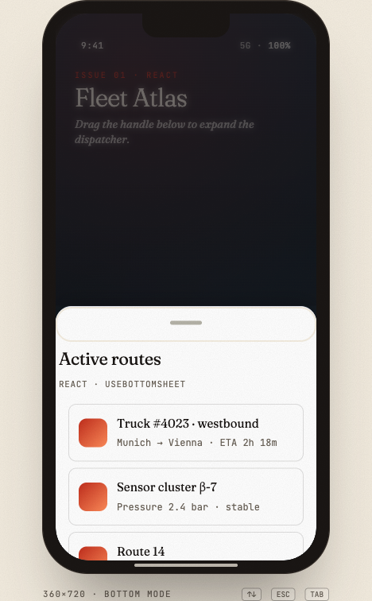
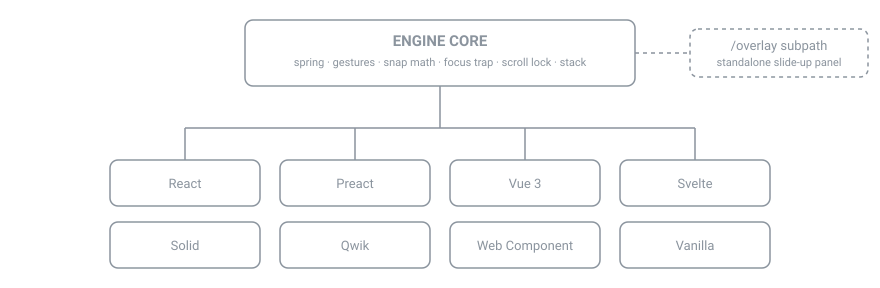

# @surdeddd/bottom-sheet

English: [README.md](./README.md)

> Универсальный headless-движок bottom sheet. **Одно ядро, восемь адаптеров, GPU-ускорение, полное покрытие тестами.**


Фреймворк-независимый примитив bottom sheet. Spring-физика, Pointer Events,
анимации только на GPU, полноценная клавиатурная a11y, перехват аппаратной
кнопки «Назад», стек из нескольких sheet — и один и тот же движок под каждым
адаптером.

## 🚀 [Живое демо → bottom-sheet-demo-ashy.vercel.app](https://bottom-sheet-demo-ashy.vercel.app)

📚 [Справочник API (typedoc) → surdeddd.github.io/BottomSheet](https://surdeddd.github.io/BottomSheet/)

<p align="center">
  <picture>
    <source media="(prefers-color-scheme: dark)" srcset="docs/screenshots/sheet-dark.png" />
    
  </picture>
</p>

<p align="center">
  
</p>

<p align="center">
  
</p>

## Возможности

Всё перечисленное ниже можно проверить в `src/` этого репозитория:

- **8 целей сборки** — React, Preact, Vue 3, Svelte 5, Solid, Qwik, Web
  Component (`<bottom-sheet>`, совместимый с Lit) и vanilla-ядро, плюс
  subpath `/overlay` (отдельная выезжающая панель).
- **4 оси** — `bottom`, `top`, `left`, `right` (через `mode`).
- **Spring-физика с переносом скорости**, плюс настройка под тип указателя
  (отдельные пороги drag для touch / mouse / pen).
- **Перехват аппаратной кнопки «Назад»** на Android — включается опцией
  `closeOnBack`.
- **Отступы с учётом `env(safe-area-inset-*)`**, чтобы ряды кнопок не
  попадали под индикатор «Домой».
- **Клавиатурный слайдер по WCAG 2.1 AA** — шаги Arrow/Home/End/Esc, focus
  trap с возвратом фокуса.
- **Стек из нескольких sheet** и типизированный реестр sheet manager.
- **Отменяемые `before-snap` / `before-close`** — переход можно
  синхронно заблокировать.
- Под капотом 500+ unit-тестов и ~200 e2e-прогонов Playwright на трёх
  браузерных движках (`mobile-chrome` / `mobile-safari` / `firefox`).

## Установка

```bash
npm i @surdeddd/bottom-sheet
```

React / Vue / Svelte указаны как **опциональные peer deps** — ставьте только
тот фреймворк, который используете: в бандл попадает только его адаптер.

## Быстрый старт

### React

```tsx
import { BottomSheet } from '@surdeddd/bottom-sheet/react';
import '@surdeddd/bottom-sheet/styles';

<BottomSheet
  snapPoints={[
    { id: 'minimized', size: 96 },
    { id: 'half', size: '45dvh' },
    { id: 'full', size: '85%' },
  ]}
  initial='minimized'
  animation='spring'
  spring={{ stiffness: 260, damping: 28 }}
  focusTrap
  closeOnEscape
  header={<h2>Search vehicles</h2>}
>
  <YourList />
</BottomSheet>;
```

[Полная документация по React →](docs/react.md)

### Vue 3

```vue
<script setup>
  import { BottomSheet } from '@surdeddd/bottom-sheet/vue';
  import '@surdeddd/bottom-sheet/styles';
</script>

<template>
  <BottomSheet
    :snap-points="snaps"
    initial="minimized"
    focus-trap
    @snap="onSnap"
  >
    <template #header><h2>Search</h2></template>
    <YourList />
  </BottomSheet>
</template>
```

[Полная документация по Vue →](docs/vue.md)

### Svelte 5

```svelte
<script lang="ts">
  import { createBottomSheet } from "@surdeddd/bottom-sheet/svelte";
  import "@surdeddd/bottom-sheet/styles";

  let sheetEl: HTMLElement | undefined = $state();
  let handleEl: HTMLElement | undefined = $state();
  let contentEl: HTMLElement | undefined = $state();

  const ctrl = createBottomSheet({
    snapPoints: [{ id: "min", size: 96 }, { id: "full", size: "85%" }],
    initial: "min",
  });

  $effect(() => {
    if (!sheetEl) return;
    return ctrl.attach({ element: sheetEl, handle: handleEl, scrollContainer: contentEl });
  });
</script>

<section class="bs-sheet" bind:this={sheetEl} data-mode="bottom">
  <div class="bs-handle" bind:this={handleEl}><h2>Search</h2></div>
  <div class="bs-content" bind:this={contentEl}><!-- list --></div>
</section>
```

[Полная документация по Svelte →](docs/svelte.md)

### Web Component (любой фреймворк)

```html
<link rel="stylesheet" href="/styles.css" />
<script type="module" src="/element.js"></script>

<bottom-sheet
  snap-points='[{"id":"min","size":96},{"id":"full","size":"85%"}]'
  initial="min"
  animation="spring"
  focus-trap="true"
>
  <h2 slot="header">Search</h2>
  <ul>
    ...
  </ul>
</bottom-sheet>
```

[Полная документация по Web Component →](docs/web-component.md)

### CDN — без сборщика и установки

Готовое подключение из статической HTML-страницы. IIFE-бандл регистрирует
`<bottom-sheet>` как побочный эффект — JS-обвязка не нужна.

```html
<!-- CDN, no bundler -->
<link
  rel="stylesheet"
  href="https://unpkg.com/@surdeddd/bottom-sheet/dist/styles.css"
/>
<script src="https://unpkg.com/@surdeddd/bottom-sheet/dist/element.iife.global.js"></script>
<bottom-sheet
  snap-points='[{"id":"min","size":96},{"id":"full","size":"85%"}]'
  initial="min"
>
  <h2 slot="header">Title</h2>
  <p>Content</p>
</bottom-sheet>
```

### Vanilla-ядро (без фреймворка)

```ts
import { BottomSheetEngine } from '@surdeddd/bottom-sheet';
import '@surdeddd/bottom-sheet/styles';

const engine = new BottomSheetEngine({
  element: document.querySelector('.bs-sheet'),
  handle: document.querySelector('.bs-handle'),
  scrollContainer: document.querySelector('.bs-content'),
  backdrop: document.querySelector('.bs-backdrop'),
  snapPoints: [
    { id: 'min', size: 96 },
    { id: 'full', size: '85%' },
  ],
  animation: 'spring',
});
engine.snapTo('full');
```

[Полная документация по vanilla →](docs/vanilla.md)

## API кратко

### Snap points

```ts
type SnapPoint =
  | number // pixels
  | `${number}%` // percent of viewport along the axis
  | 'fit' // natural height of the whole sheet (handle + header + content + footer)
  | 'content' // alias of 'fit'
  | 'full' // 100 % of axis
  | string; // any CSS length — "50dvh", "clamp(200px, 60%, 800px)"
```

### Опции движка

| Опция                | По умолчанию       | Что делает                                                                                                                 |
| -------------------- | ------------------ | -------------------------------------------------------------------------------------------------------------------------- |
| `snapPoints`         | обязательная       | Упорядоченный список `{ id, size }`                                                                                        |
| `allowed`            | все id             | Подмножество snap point, на которых sheet может остановиться сейчас                                                        |
| `initial`            | первая из allowed  | Id snap point, с которой стартовать                                                                                        |
| `mode`               | `"bottom"`         | `bottom`, `top`, `left`, `right` или логические `start` / `end`; в адаптерах React и Vue реактивна                         |
| `animation`          | `"spring"`         | `spring`, `tween`, `ios-spring`, `material-bounce`, `linear`, `snappy`                                                     |
| `settleAnimation`    | выкл.              | `"waapi"` — финальная доводка идёт как Web Animation на compositor (заранее насэмплированные spring-кейфреймы); при необходимости автоматически откатывается на rAF |
| `features`           | все по умолчанию   | `EngineFeature[]` — переопределить/расширить набор composable-фич (см. «Slim core» ниже)                                   |
| `spring`             | snappy             | `{ stiffness, damping, mass }`                                                                                             |
| `flickVelocity`      | `0.65 px/ms`       | Порог флика на мобильных                                                                                                   |
| `dragThreshold`      | `18 px`            | Если drag короче, sheet возвращается назад                                                                                 |
| `rubberBand`         | `true`             | Мягкое «резиновое» перетягивание в стиле iOS                                                                               |
| `backdropRange`      | `[0, 1]`           | Диапазон progress, в котором backdrop проявляется                                                                          |
| `screenRange`        | `[0, 1]`           | Диапазон progress, в котором проявляется контент `screen`/scrim                                                            |
| `focusTrap`          | `false`            | Удерживать Tab-фокус внутри открытого sheet                                                                                |
| `initialFocus`       | первое поле        | Элемент / селектор, получающий фокус при открытии; `false` фокусирует контейнер sheet (`tabindex=-1`) — так не открывается клавиатура iOS |
| `closeOnEscape`      | `true`             | Слушать Escape и закрывать                                                                                                 |
| `closeOnBack`        | `false`            | Перехватывать кнопку «Назад» на Android (history.popstate)                                                                 |
| `closeOnRouteChange` | `false`            | Закрывать при смене URL (патчит `pushState`/`replaceState` + popstate)                                                     |
| `lockBodyScroll`     | `true`             | Блокировка прокрутки body, безопасная для iOS (`position: fixed`)                                                          |
| `stackEffect`        | `false`            | Стек карточек как в iOS: нижние sheet уменьшаются с глубиной                                                               |
| `inertSiblings`      | `false`            | Помечать соседние элементы страницы `inert`, пока sheet открыт (полноценная модалка)                                       |
| `persistent`         | `false`            | Запретить закрытие пользователем (backdrop / Escape / «Назад»); программный `close()` работает                             |
| `disableClose`       | `false`            | Запретить любое закрытие, включая программное                                                                              |
| `disableDrag`        | `false`            | Отключить жест drag (императивные snap продолжают работать)                                                                |
| `dragFrom`           | `"handle"`         | Какие области запускают drag: `"handle"`, `"sheet"` (весь sheet) или `"zones"` (только поддеревья `[data-bs-drag]`). Если handle не задан, по умолчанию `"sheet"`. `[data-bs-no-drag]` исключает поддерево в любом режиме. Также `setDragFrom()` / `getDragFrom()` — переключение перемонтирует жест, без перемонтирования компонента |
| `dragFromContent`    | `true`             | Тянет ли sheet touch-жест на scroll-контейнере; переопределяется для отдельной snap point через `{ id, size, dragFromContent: false }`. Также `setDragFromContent()` |
| `fitContentToSnap`   | `false`            | Делает весь scroll-контейнер достижимым, а footer видимым на каждой snap point, а не только на самой большой. По умолчанию выключено; см. [Контент достижим на каждой snap point](#контент-достижим-на-каждой-snap-point) |
| `radius`             | токен по умолчанию | Радиус скругления (`string` — CSS-длина или `number` — px); также `setRadius()`                                            |
| `maxHeight`          | нет                | Ограничение высоты sheet. `number` (px) или строка (`"92dvh"`, `"50%"`), пересчитывается при смене viewport / ориентации   |
| `returnFocusTo`      | opener             | Куда вернуть фокус при закрытии — `HTMLElement`, строка-селектор или фабрика `() => HTMLElement`                           |

### Anchored-элементы, docked-бары и сцены scrim

Закрепляйте UI вокруг sheet — он едет вместе с ним на compositor (ноль JS на
кадр) и показывается/скрывается по состоянию с настраиваемой анимацией:

```ts
engine.addAnchor({
  element: closeBtn,
  position: 'sheet-top-right', // rides the sheet edge; 9 screen positions too
  showOn: ['half', 'full'],    // snap ids or a predicate
  animation: 'pop',            // fade | scale | slide | pop | custom keyframes
});

engine.addAnchor({
  element: tabBar,
  position: 'dock-bottom',     // full-width bar; the sheet slides under it
});

engine.setScrimStages({
  stages: [
    { for: 'peek', element: teaser },
    { forRange: [0.5, 1], element: expanded },
  ],
  animation: 'fade',
});
```

[Полная документация по anchors и stages →](docs/anchors.md)

### События

```ts
engine.on('snap', ({ id, size, progress }) => {}); // settled state change
engine.on('open', ({ id }) => {}); // 0 → >0 (enter starts)
engine.on('opened', ({ id }) => {}); // enter settled
engine.on('close', () => {}); // → 0 (exit starts)
engine.on('closed', () => {}); // exit settled
engine.on('dragstart', ({ size }) => {});
engine.on('drag', ({ size, delta }) => {}); // ~60 fps — payload is pooled, don't retain
engine.on('dragend', ({ size, velocity }) => {});
engine.on('progress', ({ value, size }) => {}); // ~60 fps

// Cancelable — call cancel() synchronously to veto the transition:
engine.on('before-snap', ({ id, size, previousId, cancel }) => {});
engine.on('before-close', ({ reason, cancel }) => {}); // reason: programmatic | backdrop | escape | back
```

### Императивный API

```ts
engine.snapTo('half');
engine.open(); // → first allowed snap with resolved size > 0
engine.close(reason?); // → first snap that resolves to size 0, else first allowed
engine.expand(); // → largest allowed snap
engine.collapse(); // → smallest allowed snap with size > 0
engine.setAllowed(ids, snapId); // dynamic allowlist
engine.setSnapPoints(points); // re-measure
engine.recompute(); // re-measure a 'fit' / 'content' snap on demand
engine.getResolvedSnaps(); // → [{ id, size }] resolved to pixels right now
engine.setPersistent(bool); // toggle persistence (block dismissal) at runtime
engine.setDisableClose(bool); // toggle close-blocking at runtime
engine.setDisableDrag(bool); // toggle the drag gesture at runtime
engine.setRadius('28px'); // corner radius
engine.setMaxHeight('92dvh'); // height cap (re-resolved on viewport change)
engine.canDismiss(); // false when persistent / disableClose
engine.isTop(); // top of the multi-sheet stack?
engine.depth(); // open sheets above this one
engine.destroy(); // remove listeners + cancel animation
```

`initial` запускает sheet **сразу открытым** на любой snap point, размер
которой разрешается в `> 0` (события `open` / `opened` не срабатывают — перехода
для анонса нет). Вызывать `open()` / `snapTo()` **синхронно в тике монтирования
безопасно** — задержка через `requestAnimationFrame` / `nextTick` не нужна, в том
числе для `fit` / `content` и телепортированных sheet. Sheet, смонтированный
скрытым (предок с `display:none`), «лечится» и один раз испускает свою
последовательность открытия при появлении. См.
[Architecture → Opening at construction](docs/ARCHITECTURE.md).

### Runtime API scrim

Scrim — это затемняющий слой за sheet или вокруг него (`screenComponent`). Все
свойства scrim можно менять в рантайме — перемонтирование не нужно.

| Метод                                                  | Назначение                                                                                                                                       |         |                                                                        |
| ------------------------------------------------------ | ------------------------------------------------------------------------------------------------------------------------------------------------ | ------- | ---------------------------------------------------------------------- |
| `setScrimMode('full' \                                 | 'above-sheet' \                                                                                                                                  | 'off')` | Переключает позиционирование в рантайме. `'off'` полностью отключает слой scrim. |
| `setScrimEnabled(boolean)`                             | Удобный переключатель — сохраняет/восстанавливает диапазоны opacity.                                                                             |         |                                                                        |
| `setScrimTapToClose(boolean)`                          | Устанавливает/снимает закрытие по клику на scrim.                                                                                                |         |                                                                        |
| `setScrimColor(color \                                 | null)` / `setScrimBlur(blur \                                                                                                                    | null)`  | Живое изменение цвета и blur через backdrop-filter. `null` сбрасывает. |
| `setScrimInteractive(boolean)`                         | Переключает `pointer-events` на слое scrim.                                                                                                      |         |                                                                        |
| `setBackdropRange([s, e])` / `setScreenRange([s, e])`  | Отображение диапазона на opacity (progress 0..1 → opacity 0..1).                                                                                 |         |                                                                        |
| `setScrim({ ... })`                                    | Пакетное обновление — применяет preset и отдельные поля за один проход с единственным `applySize`.                                               |         |                                                                        |
| `setScrimOverlay({ children, position, interactive })` | Вставляет позиционированный плавающий элемент в область scrim. Возвращает функцию снятия. Полезно для мониторинговых UX вида «затемнить всё, кроме этого бейджа». |         |                                                                        |
| `getScrimState()`                                      | Read-only снимок `{ mode, enabled }`. Стабильный публичный API для интроспекции без привязки к внутренностям.                                    |         |                                                                        |

**Пресеты**: `'subtle' | 'standard' | 'monitoring' | 'cinematic'` — задаются опцией конструктора `scrimPreset` или через `setScrim({ preset })`.

### Runtime API overlay

Overlay-движок (`@surdeddd/bottom-sheet/overlay`) — это отдельная выезжающая
панель, которая повторяет для контента ту же runtime-изменяемость, что и scrim.

| Метод                           | Назначение                                                                                      |           |                                                                                                      |
| ------------------------------- | ----------------------------------------------------------------------------------------------- | --------- | ---------------------------------------------------------------------------------------------------- |
| `setOverlayChildren(node \      | fragment \                                                                                      | factory)` | Заменяет содержимое overlay в рантайме. Принимает `Node`, `DocumentFragment` или фабрику `() => Node`. |
| `clearOverlayChildren()`        | Удаляет вставленный контент.                                                                    |           |                                                                                                      |
| `setOverlay({ children, ... })` | Пакетное обновление — `children` входит в число допустимых полей наряду с позиционированием и переопределениями preset. |           |                                                                                                      |

**Пресеты**: `OverlayPreset` — это `'sheet' | 'dialog' | 'sidebar' | 'toast'`;
доступны как константа-словарь `OVERLAY_PRESETS` и принимаются в `setOverlay({ preset })`.

### Sheet manager (реестр по маршрутам)

```ts
import { createSheetManager } from "@surdeddd/bottom-sheet";

const sheets = createSheetManager<"home" | "marker" | "panorama">({
  home:   { snapPoints: [...], allowed: ["min", "half", "full"], onOpen: loadHome },
  marker: { snapPoints: [...], allowed: ["half", "full"],         onOpen: focusMarker, onClose: blur },
});

// In your route watcher:
sheets.transition(prev, next);
const cfg = sheets.resolve(currentRoute); // typed!
```

## Производительность

Три осознанных решения держат 60 fps даже на Android среднего уровня:

1. **Позиционирование через transform.** `height` sheet выставляется один раз
   по самой большой snap point; изменения размера применяются через
   `transform: translate3d(...)`. Всё остаётся на compositor — ноль layout на
   кадр.
2. **Sub-stepping spring с единственной записью в DOM.** Жёсткие пружины
   интегрируются внутри на 240 Гц ради стабильности, но движок пишет в DOM
   ровно один раз за `requestAnimationFrame`.
3. **React-снимок только установившегося состояния.** `useSyncExternalStore`
   обновляется лишь на `snap` / `dragstart` / `dragend`. Пиксели drag и кадры
   анимации передаются через CSS-переменные (`--bs-progress`, `--bs-size`) и
   прямые императивные подписки — никаких ре-рендеров React на каждом кадре.

## Slim core и composable-фичи

Стандартный `BottomSheetEngine` поставляется со всеми опциональными
поведениями. Если нужно только необходимое, импортируйте slim core (~17.5 KB
gzip против ~23 KB) и подключайте только нужные фичи:

```ts
import { BottomSheetCore } from '@surdeddd/bottom-sheet/core';
import { routeFeature, contentSwipeFeature } from '@surdeddd/bottom-sheet/features';

const engine = new BottomSheetCore({
  element, handle, snapPoints,
  closeOnBack: true,
  features: [routeFeature(), contentSwipeFeature()],
});
```

Опциональные фичи: `routeFeature()` (`closeOnBack` / `routedTo` /
`closeOnRouteChange`), `visualViewportFeature()` (ограничение под экранную
клавиатуру), `contentSwipeFeature()`, `persistFeature()`, `autoCollapseFeature()`.
Всё остальное (жесты, математика snap, самовосстановление при resize, a11y-слайдер,
focus trap, scroll lock, scrim, стек) — часть ядра. Если задать опцию, фича
которой не подключена, в dev-режиме будет одно предупреждение, а в production
опция игнорируется. Собственные фичи реализуют `{ name, install(ctx) }` — тот же
шов, что используют встроенные.

### WebGL-рендерер (опционально)

```ts
import { webglRenderer } from '@surdeddd/bottom-sheet/webgl';

const engine = new BottomSheetEngine({
  element, handle, snapPoints,
  features: [webglRenderer({ jelly: 0.6 })],
});
```

Рисует поверхность sheet — панель, скругления, тень, блик по краю — на GPU. В
момент начала drag текст sheet переносится в текстуру, так что весь sheet
изгибается как единая поверхность, а после остановки возвращается обратно в
DOM. Layout, прокрутка, жесты и дерево доступности из DOM никуда не уходят.
4.2 KB gzip, и только если вы его импортируете.
Откатывается на DOM-рендерер — молча и даже посреди сессии, если потребуется, —
когда WebGL недоступен, при `prefers-reduced-motion` или если браузер сбросил
GL-контекст.

[Полная документация по WebGL →](docs/webgl.md)

### Debug overlay

```ts
import { attachDebugOverlay } from '@surdeddd/bottom-sheet/debug';

const detach = attachDebugOverlay(engine);
```

Фиксированная dev-панель с активной snap point, текущими size/progress,
флагами drag/animate и списком разрешённых snap — работает исключительно на
публичных событиях движка и поставляется отдельным entry, так что в
продакшн-бандлы не попадает.

### Qwik SSR

Пакет объявляет поле `qwik`, указывающее на
`dist/qwik-lib/index.qwik.mjs`. Приложения на Qwik подхватывают адаптер
автоматически как vendor root: оптимизатор на стороне потребителя режет его на
QRL-чанки, а `renderToString` выдаёт возобновляемый (`q:container="paused"`)
sheet. Дополнительная конфигурация не нужна —
`import { BottomSheet } from '@surdeddd/bottom-sheet/qwik'` по-прежнему
работает для CSR, а Qwik City SSR теперь работает из коробки.

## Темизация

Весь внешний вид управляется CSS custom properties. Переопределяйте где угодно:

```css
.bs-root {
  --bs-surface: #18181b;
  --bs-handle-color: #71717a;
  --bs-radius: 28px;
  --bs-shadow: 0 -8px 30px rgba(0, 0, 0, 0.6);
}
```

Движок записывает в элемент sheet `--bs-progress` (0..1) и `--bs-size` (px) —
управляйте любой CSS-анимацией от drag без единой строки JS:

```css
.fab {
  transform: scale(calc(1 - var(--bs-progress) * 0.3));
}
.map-canvas {
  filter: blur(calc(var(--bs-progress) * 8px));
}
.search-input {
  opacity: calc(1 - var(--bs-progress));
}
```

> **z-index принадлежит движку.** Контроллер стека при каждом изменении стека
> перезаписывает inline-`z-index` у `.bs-sheet`, `.bs-backdrop` и обёрток
> anchor (база `100`, шаг `10` на уровень глубины), поэтому заданное вами
> значение будет перезаписано и начнёт конфликтовать со стеком. Чтобы
> расположить слой sheet относительно UI приложения, переместите контейнер
> (цель teleport / родителя `.bs-root`) или измените порядок открытия — не
> стилизуйте `z-index` у элементов, которыми управляет bs. См.
> [Architecture → z-index & the sheet stack](docs/ARCHITECTURE.md).

**У каждого sheet свой backdrop.** Откройте список, затем поверх него sheet с
деталями — оба backdrop остаются активными: затемнение усиливается с каждым
уровнем, а нижний sheet остаётся замаскированным всё время, пока закрывается
верхний, так что касания не доходят до страницы посреди анимации. Каждый
backdrop следует за progress собственного sheet, поэтому закрывающийся
«погребённый» sheet убирает свой scrim. Стек сохраняет порядок, в котором
sheet начали открываться: sheet, открытый, пока другой ещё анимируется, остаётся
сверху. Если нужен единый уровень затемнения, передайте `backdrop={false}`
(`:backdrop="false"` во Vue) тем sheet, которые открываете поверх.

### Контент достижим на каждой snap point

Sheet всегда имеет высоту своей самой большой snap point и двигается через
transform — именно это держит drag на compositor. Цена: ниже самой большой
snap point низ scroll-контейнера оказывается под краем экрана ровно на
`largest snap − current size`. На половинной snap point прокручивать можно, но
последние строки не появятся, пока sheet не вытянут выше.

`fitContentToSnap` закрывает этот зазор:

```tsx
<BottomSheet snapPoints={points} fitContentToSnap>
  <LongList />
</BottomSheet>
```

Когда sheet останавливается, движок записывает скрытую величину в
`--bs-content-inset`, а стили уменьшают `.bs-content` ровно на неё, так что
scroll-контейнер заканчивается у края экрана: последняя строка, поле в фокусе
и полоса прокрутки остаются в видимой части, а ползунок рассчитан на то, что
реально видно. В момент начала движения sheet переключается на контейнер
полной высоты со спейсером такого же размера в конце списка, поэтому строки
ниже края уже разложены, когда drag или анимация их открывает. Переключение
меняет и бокс, и диапазон прокрутки на одну и ту же величину, так что на
экране ничего не сдвигается. Это один layout при старте движения и один при
остановке, ни одного на кадр, поэтому движение остаётся чисто transform-овым.
Пока sheet движется, список, прокрученный до самого конца, удерживается на
месте на экране, а не уезжает вверх вместе с sheet и не откатывается обратно
в конце.

У footer та же проблема, и лечится она так же. Он последний в sheet, поэтому
ниже самой большой snap point он оказывается под краем экрана вместе с концом
списка. При включённом `fitContentToSnap` уменьшенный контейнер ставит footer
у низа видимой части sheet в покое, а пока sheet движется, стили поднимают
`.bs-footer` на `--bs-size − --bs-max-size`, так что он едет по этому краю на
каждом кадре drag или анимации — опять же без layout. Список заканчивается над
ним, а не под ним. На snap point, слишком короткой для обоих, footer уходит под
край экрана, а не закрывает handle. WebGL-рендерер получает ту же раскладку;
пока sheet движется, его footer закрашивается цветом поверхности, а drag
переносит список в текстуру, которая следует за позицией прокрутки списка, так
что список, удерживаемый в конце, остаётся там же.

#### Прокрутка списка на каждой snap point на таче

Сделать конец списка *достижимым* и дать пальцу *прокрутить* до него — две
разные вещи. По умолчанию свайп, начатый на контенте, тянет sheet, пока он не
дойдёт до самой большой snap point, и только потом прокручивает список — так
ведут себя нативные sheet. На мыши или трекпаде колесо прокручивает на любой
snap point, на таче — нет. Чтобы прокручивать пальцем на половинной snap point,
отдайте свайпы по контенту списку, а handle (и header) оставьте для движения
sheet:

```tsx
<BottomSheet snapPoints={points} fitContentToSnap dragFromContent={false}>
  <LongList />
</BottomSheet>
```

`dragFromContent` можно задать и для отдельной snap point: это сохраняет
нативное ощущение pull-to-expand на маленьком peek и освобождает список начиная
с половины:

```ts
const points = [
  { id: "peek", size: 120 },
  { id: "half", size: "50%", dragFromContent: false },
  { id: "full", size: "90%", dragFromContent: false },
];
```

Работает для `bottom`-sheet и ожидает, что scroll-контейнер — растущий
потомок flex-колонки sheet, как `.bs-content`. Для любого другого контейнера
атрибут `data-bs-fit-content` на sheet принимает значения `rest` или `moving`,
а `--bs-content-inset` хранит скрытую величину: в покое уменьшайте контейнер на
неё, а при движении добавляйте её как отступ в конец содержимого. На slim core
добавьте `contentFitFeature()` из `@surdeddd/bottom-sheet/features`.

### Scrim, blur и высокий контраст

| Токен                    | По умолчанию | Область                                                  |
| ------------------------ | ------------ | -------------------------------------------------------- |
| `--bs-scrim-color`       | transparent  | Заливка слоя scrim (`.bs-screen`)                        |
| `--bs-scrim-blur`        | `0px`        | `backdrop-filter: blur()`, применяемый к слою scrim      |
| `--bs-header-min-height` | `0px`        | Минимальная высота области `.bs-header`                  |

`--bs-scrim-blur` включает настоящий blur через `backdrop-filter` на scrim —
задайте его для эффекта матового стекла (или используйте пресеты scrim
`monitoring` / `cinematic`, которые задают и цвет, и blur). В режиме Windows
High Contrast / `forced-colors` таблица стилей содержит блок
`@media (forced-colors: active)`, чтобы поверхность sheet, handle и кольцо
фокуса оставались видимыми.

### Отступы и раскладка

Отступы каждой области — это токен: переопределите или обнулите его, чтобы
контент шёл от края до края. Значения по умолчанию соответствуют встроенному
виду. Задавайте переменную на хосте / `.bs-root` / `:root`; custom properties
наследуются через shadow-границу Web Component, поэтому одно и то же
переопределение работает для всех адаптеров:

| Токен                  | По умолчанию          | Область                 |
| ---------------------- | --------------------- | ----------------------- |
| `--bs-content-padding` | `0 16px 16px`         | прокручиваемое тело     |
| `--bs-handle-padding`  | `8px 16px 4px`        | полоса захвата (сверху) |
| `--bs-header-padding`  | `0 16px 8px`          | слот header             |
| `--bs-footer-padding`  | `12px 16px (+ inset)` | слот footer             |

(Значение footer по умолчанию — `12px 16px calc(12px + env(safe-area-inset-bottom))`;
оно не даёт кнопкам действий оказаться под индикатором «Домой».)

```css
.bs-root { --bs-content-padding: 0; }               /* full-bleed content */
.bs-root { --bs-content-padding: 0 24px 24px; }      /* custom insets        */
bottom-sheet { --bs-handle-padding: 0; }             /* Web Component, from the host */
```

`maxHeight` (проп или атрибут `max-height` у элемента) ограничивает sheet:
snap point `'content'` / `'fit'`, превышающая ограничение, останавливается
вплотную к краю, а тело прокручивается внутри — sheet никогда не отрывается от
своей опоры, а `--bs-size` всегда равен отрисованной высоте.

## Демо

```bash
npm run demo
# http://localhost:5173
```

Редакторское демо показывает адаптеры, каждый жест, каждый режим
(`bottom · top · left · right · overlay`) и живые показания движка (активная
snap point, progress, скорость, FPS). В углу переключатели EN/RU и светлой/тёмной темы.

## Справа налево (RTL)

`left` и `right` — физические края и остаются физическими. Для интерфейсов,
которые зеркалятся вместе с направлением письма, используйте логические
режимы — `start` и `end` разрешаются относительно направления, действующего
для sheet, так что `start` — левый край в английском и правый в арабском:

```ts
new BottomSheetEngine({ element, handle, mode: 'start', snapPoints });
```

[Полная документация по RTL →](docs/rtl.md)

## Поддержка браузеров

Базовый уровень: Chrome/Edge 80, Safari 13.1 (iOS 13.4), Firefox 72 — его
задают целевая сборка ES2020 и API, без которых движок работать не может
(Pointer Events, CSS custom properties, `ResizeObserver`). Всё остальное, от
`inert` до `backdrop-filter` и WebGL, проверяется на наличие и деградирует
мягко.

[Полная матрица поддержки →](docs/browser-support.md)

## Тестирование

```bash
npm test                 # 500+ unit tests via vitest + happy-dom
npx playwright test      # e2e via Playwright on mobile-Chrome / mobile-Safari / Firefox
npm run typecheck        # TypeScript --noEmit
```

CI гоняет все три набора на Node 20.19 / 22 при каждом PR и теге.

## Участие в разработке

1. `npm install`
2. `npm run dev` — tsup в watch-режиме
3. `npm run demo` — dev-сервер Vite с живым демо
4. `npm test` — vitest в watch-режиме
5. Откройте PR с сфокусированным диффом. Слияние закрыто матрицей CI.

## Лицензия

MIT — см. [LICENSE](LICENSE).
