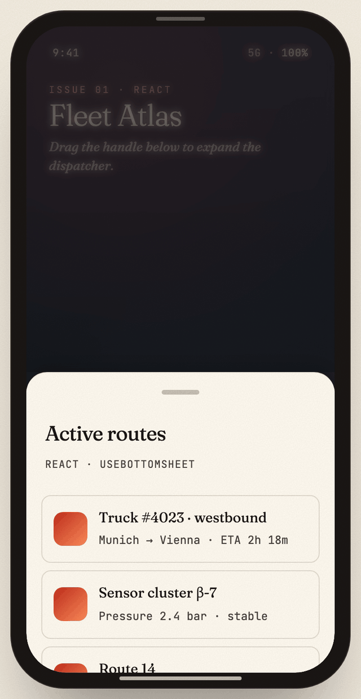
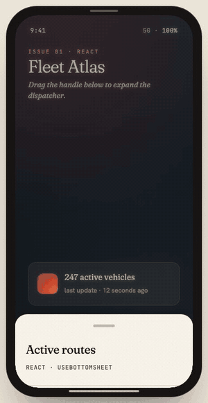

# @surdeddd/bottom-sheet

Нижняя шторка (bottom sheet), боковая панель и модальный лист для веба. Один
движок жестов с точками привязки, пружинной физикой и управлением с
клавиатуры, и тот же движок под адаптерами для **React, Vue 3, Svelte 5,
Solid, Qwik, Preact** и под **веб-компонентом** `<bottom-sheet>`, который
работает в Angular, Lit, Astro и в обычном HTML.

[](https://www.npmjs.com/package/@surdeddd/bottom-sheet)
[](https://www.npmjs.com/package/@surdeddd/bottom-sheet)


**[Живое демо](https://bottom-sheet-demo-ashy.vercel.app)** ·
**[Справочник API](https://surdeddd.github.io/BottomSheet/)** ·
[История изменений](CHANGELOG.md) ·
[English](https://github.com/Surdeddd/BottomSheet/blob/main/README.md)

<p align="center">
  <picture>
    <source media="(prefers-color-scheme: dark)" srcset="docs/screenshots/sheet-dark.png" />
    
  </picture>
  
</p>

## Чем она отличается

- **Один движок на все фреймворки.** Компонент в React ведёт себя так же,
  как в Vue, Svelte, Solid, Qwik или в веб-компоненте: это тонкие адаптеры
  над одним ядром.
- **Точки привязки в любых единицах.** Пиксели, проценты, `fit` (высота
  самого содержимого) или любая длина CSS: `50dvh`,
  `clamp(200px, 60%, 800px)`.
- **Четыре края.** `bottom`, `top`, `left`, `right`, а также `start` и `end`,
  которые следуют за направлением письма.
- **Ощущается как нативная.** Пружина, которая подхватывает скорость пальца,
  резиновое сопротивление за крайней точкой, отдельные пороги для пальца и
  мыши, движение только на композиторе.
- **Доступность.** Ручка работает как слайдер с клавиатуры, фокус можно
  запереть в шторке и вернуть обратно, всё за модальной шторкой получает
  `inert`, учитываются reduced motion и forced colors.
- **Знает про телефон.** Встаёт на экранную клавиатуру, учитывает безопасные
  зоны, закрывается кнопкой «Назад», блокирует прокрутку страницы способом,
  который работает в iOS.
- **Стек.** Несколько шторок открыты одновременно, у каждой свой бэкдроп и
  своя область фокуса.
- **Небольшой размер.** 26.2 KB gzip у полного движка, 22.5 KB у
  облегчённого ядра, зависимостей в рантайме нет.

## Установка

```bash
npm i @surdeddd/bottom-sheet
```

Фреймворки объявлены необязательными peer-зависимостями: ставится только
тот, которым вы пользуетесь.

## Быстрый старт

### Модальная шторка по кнопке

```tsx
import { useState } from 'react';
import { BottomSheet } from '@surdeddd/bottom-sheet/react';
import '@surdeddd/bottom-sheet/styles';

export function Filters() {
  const [open, setOpen] = useState(false);

  return (
    <>
      <button onClick={() => setOpen(true)}>Filters</button>

      <BottomSheet
        open={open}
        onOpenChange={setOpen}
        snapPoints={[
          { id: 'closed', size: 0 },
          { id: 'open', size: 'fit' },
        ]}
        focusTrap
        header={<h2>Filters</h2>}
      >
        <FilterForm />
      </BottomSheet>
    </>
  );
}
```

Пропсу `open` нужна точка привязки размером `0`: это и есть закрытое
состояние. Тап по бэкдропу, Escape и перетаскивание вниз закрывают шторку и
сообщают об этом через `onOpenChange`.

### Шторка, которая всегда на экране

Как в картах: полоса снизу, которую тянут вверх.

```tsx
<BottomSheet
  snapPoints={[
    { id: 'peek', size: 96 },
    { id: 'half', size: '45dvh' },
    { id: 'full', size: '90%' },
  ]}
  initial="peek"
  header={<h2>Nearby</h2>}
>
  <PlaceList />
</BottomSheet>
```

### Другие фреймворки

<details>
<summary><b>Vue 3</b></summary>

```vue
<script setup lang="ts">
import { ref } from 'vue';
import { BottomSheet } from '@surdeddd/bottom-sheet/vue';
import '@surdeddd/bottom-sheet/styles';

const open = ref(false);
const points = [
  { id: 'closed', size: 0 },
  { id: 'open', size: 'fit' },
];
</script>

<template>
  <button @click="open = true">Filters</button>
  <BottomSheet v-model:open="open" :snap-points="points" focus-trap>
    <template #header><h2>Filters</h2></template>
    <FilterForm />
  </BottomSheet>
</template>
```

[Гайд по Vue →](docs/vue.md)

</details>

<details>
<summary><b>Svelte 5</b></summary>

```svelte
<script lang="ts">
  import { BottomSheet } from '@surdeddd/bottom-sheet/svelte';
  import '@surdeddd/bottom-sheet/styles';

  let open = $state(false);
</script>

<button onclick={() => (open = true)}>Filters</button>

<BottomSheet
  bind:open
  snapPoints={[{ id: 'closed', size: 0 }, { id: 'open', size: 'fit' }]}
  focusTrap
>
  {#snippet header()}<h2>Filters</h2>{/snippet}
  {#snippet children()}<FilterForm />{/snippet}
</BottomSheet>
```

[Гайд по Svelte →](docs/svelte.md)

</details>

<details>
<summary><b>Solid</b></summary>

```tsx
import { createSignal } from 'solid-js';
import { BottomSheet } from '@surdeddd/bottom-sheet/solid';
import '@surdeddd/bottom-sheet/styles';

export function Filters() {
  const [open, setOpen] = createSignal(false);
  return (
    <>
      <button onClick={() => setOpen(true)}>Filters</button>
      <BottomSheet
        open={open()}
        onOpenChange={setOpen}
        snapPoints={[{ id: 'closed', size: 0 }, { id: 'open', size: 'fit' }]}
        focusTrap
        header={<h2>Filters</h2>}
      >
        <FilterForm />
      </BottomSheet>
    </>
  );
}
```

[Гайд по Solid →](docs/solid.md)

</details>

<details>
<summary><b>Qwik</b></summary>

```tsx
import { component$, useSignal } from '@builder.io/qwik';
import { BottomSheet } from '@surdeddd/bottom-sheet/qwik';
import '@surdeddd/bottom-sheet/styles';

export const Filters = component$(() => {
  const open = useSignal(false);
  return (
    <>
      <button onClick$={() => (open.value = true)}>Filters</button>
      <BottomSheet
        open={open.value}
        onOpenChange$={next => (open.value = next)}
        snapPoints={[{ id: 'closed', size: 0 }, { id: 'open', size: 'fit' }]}
        focusTrap
      >
        <h2 q:slot="header">Filters</h2>
        <FilterForm />
      </BottomSheet>
    </>
  );
});
```

[Гайд по Qwik →](docs/qwik.md)

</details>

<details>
<summary><b>Веб-компонент</b> (Angular, Lit, Astro, обычный HTML)</summary>

```html
<script type="module">
  import '@surdeddd/bottom-sheet/element';
</script>

<button onclick="document.querySelector('bottom-sheet').open()">Filters</button>

<bottom-sheet snap-points="closed:0,open:fit" focus-trap="true">
  <h2 slot="header">Filters</h2>
  <form>…</form>
</bottom-sheet>
```

Стили элемент несёт в собственном shadow root, отдельная таблица стилей не
нужна. Без сборщика подключите его с CDN:

```html
<script src="https://unpkg.com/@surdeddd/bottom-sheet/dist/element.iife.global.js"></script>
```

[Гайд по веб-компоненту →](docs/web-component.md)

</details>

<details>
<summary><b>Без фреймворка</b></summary>

```html
<div class="bs-root">
  <div class="bs-backdrop"></div>
  <section class="bs-sheet" data-mode="bottom" role="dialog" aria-label="Filters">
    <div class="bs-handle" role="slider" tabindex="0" aria-label="Resize sheet"></div>
    <div class="bs-content">…</div>
  </section>
</div>
```

```ts
import { BottomSheetEngine } from '@surdeddd/bottom-sheet';
import '@surdeddd/bottom-sheet/styles';

const root = document.querySelector('.bs-root')!;
const sheet = new BottomSheetEngine({
  element: root.querySelector('.bs-sheet')!,
  handle: root.querySelector('.bs-handle')!,
  scrollContainer: root.querySelector('.bs-content')!,
  backdrop: root.querySelector('.bs-backdrop')!,
  snapPoints: [
    { id: 'closed', size: 0 },
    { id: 'open', size: 'fit' },
  ],
  initial: 'closed',
});

document.querySelector('#filters')!.addEventListener('click', () => sheet.open());
```

[Гайд по движку без фреймворка →](docs/vanilla.md)

</details>

Preact: `@surdeddd/bottom-sheet/preact` — это React-адаптер, работающий через
`preact/compat` ([гайд](docs/preact.md)). В Angular, Lit и Astro используется
веб-компонент или сам движок: [Angular](docs/angular.md), [Lit](docs/lit.md),
[Astro](docs/astro.md).

Гайды в `docs/` написаны на английском.

## Основные понятия

**Точки привязки** (snap points) — размеры, на которых шторка может
остановиться. У каждой есть `id`, по которому к ней обращаются, и `size`:

```ts
type SnapPoint =
  | number                 // пиксели
  | `${number}%`           // доля окна вдоль оси шторки, а с bounds: "container" — её контейнера
  | 'fit' | 'content'      // высота самой шторки: ручка, шапка, содержимое, подвал
  | 'full'                 // вся ось
  | string;                // любая длина CSS: "50dvh", "clamp(200px, 60%, 800px)"
```

Точка размером `0` — это **закрытое** состояние. Шторку без такой точки
нельзя закрыть, только свернуть до самой маленькой.

У точки может быть `label`: так её назовёт скринридер, например
`{ id: 'peek', size: 120, label: 'Свёрнута' }`. Без него читается `id`.

**Три слоя.** Сама *шторка*, *бэкдроп*, который затемняет страницу, и
необязательный *скрим* (`screen`) для содержимого, которое проявляется за
шторкой: превью карты, размытая подложка.

**Состояние** — один объект: `{ activeId, activeLabel, size, progress, phase,
isDragging, isAnimating }`. `progress` идёт от 0 на самой маленькой разрешённой точке до
1 на самой большой. `phase` принимает значения `closed`, `opening`, `open` и
`closing`.

## API

Все опции, методы и события ниже работают одинаково в каждом адаптере.
Компоненты принимают опции как пропсы (`focus-trap` в шаблонах Vue,
`focus-trap="true"` у веб-компонента).

### Опции

Размер и положение

| Опция | По умолчанию | Что делает |
| --- | --- | --- |
| `snapPoints` | обязательна | Список `{ id, size, label? }` |
| `allowed` | все id | Точки, на которых шторка может остановиться сейчас |
| `initial` | первая разрешённая | Точка, с которой шторка начинает. Если её размер больше `0`, шторка появляется открытой, без события `open` |
| `mode` | `"bottom"` | Край: `bottom`, `top`, `left`, `right` или `start` / `end` |
| `maxHeight` | нет | Предел размера шторки: пиксели или длина CSS, которая пересчитывается при изменении вьюпорта |
| `bounds` | `"window"` | От чего считаются `"full"`, проценты и предел размера. `"container"` меряет от ближайшего позиционированного предка шторки и держит шторку, её фон и скрим внутри него. [Подробнее](#шторка-внутри-панели) |
| `radius` | `20px` | Радиус скругления |
| `fitContentToSnap` | `false` | Вся прокручиваемая область и подвал достижимы на каждой точке, а не только на самой большой. [Подробнее](docs/content-fit.md) |

Движение

| Опция | По умолчанию | Что делает |
| --- | --- | --- |
| `animation` | `"spring"` | `spring`, `ios-spring`, `material-bounce`, `snappy`, `tween`, `linear` |
| `spring` | из пресета | `{ stiffness, damping, mass }` |
| `duration`, `easing` | `220`, ease-out-back | Длительность в мс и кривая `(t) => number` для анимации `tween` |
| `settleAnimation` | выключена | `"waapi"` выполняет посадку как Web Animation на композиторе |
| `respectReducedMotion` | `true` | При `prefers-reduced-motion: reduce` шторка сразу встаёт на точку |
| `viewTransitions` | `false` | Переход между точками через `document.startViewTransition()`, если браузер его умеет |

Жесты

| Опция | По умолчанию | Что делает |
| --- | --- | --- |
| `dragFrom` | `"handle"` | Откуда можно начать перетаскивание: с ручки (`handle`), со всей шторки (`sheet`) или только из зон `[data-bs-drag]` (`zones`). `[data-bs-no-drag]` исключает поддерево. Нажатие, с которого началось перетаскивание, отменяет нативное перетаскивание ссылки или выделенного текста под указателем; кнопка, ссылка или поле под ним по-прежнему получают клик. У шторки без ручки по умолчанию `sheet` |
| `dragFromContent` | `true` | Тянет ли шторку касание по прокручиваемой области. Можно задать для отдельной точки: `{ id, size, dragFromContent: false }` |
| `disableDrag` | `false` | Отключает жест; методы продолжают работать |
| `rubberBand` | `true` | Мягкое сопротивление за крайней точкой |
| `flickVelocity` | `0.65` px/мс | Скорость, с которой отпускание пальца или пера считается броском. Для мыши порог фиксированный: 0.4 |
| `dragThreshold` | `18` px | Перетаскивание пальцем или пером короче этого возвращает шторку назад. Для мыши порог фиксированный: 12 |

Закрытие

| Опция | По умолчанию | Что делает |
| --- | --- | --- |
| `closeOnEscape` | `true` | Escape закрывает верхнюю шторку |
| `closeOnBack` | `false` | Кнопка «Назад» закрывает шторку и не уводит со страницы |
| `routedTo` | нет | URL, который показывается, пока шторка открыта; «Назад» закрывает её и возвращает адрес |
| `closeOnRouteChange` | `false` | Закрыть при смене URL |
| `persistent` | `false` | Пользователь не может закрыть шторку: ни тапом по бэкдропу, ни Escape, ни «Назад», ни жестом, ни клавишами. `close()` по-прежнему закрывает |
| `disableClose` | `false` | Шторку не закрывает ничто, включая `close()` |

Фокус и доступность

| Опция | По умолчанию | Что делает |
| --- | --- | --- |
| `focusTrap` | `false` | Переносит фокус в шторку при открытии, держит Tab внутри, пока она верхняя, и возвращает фокус при закрытии. Попап, который рисуется в другом месте, пометьте `data-bs-focus-allow`, и фокус сможет туда уйти |
| `initialFocus` | первый фокусируемый | Вместе с `focusTrap`: элемент или селектор, который получит фокус при открытии. Первый фокусируемый элемент — ручка; `false` ставит фокус на саму шторку |
| `returnFocusTo` | нет | Элемент, селектор или функция: куда отправить фокус при закрытии. Ловушка фокуса и так возвращает его туда, где он был |
| `inertSiblings` | `false` | Делает всё вне шторки `inert`, пока она верхняя |
| `lockBodyScroll` | `true` | Блокирует прокрутку страницы, пока шторка открыта |

Бэкдроп и скрим

| Опция | По умолчанию | Что делает |
| --- | --- | --- |
| `backdropRange` | `[0, 1]` | Отрезок `progress`, на котором проявляется бэкдроп |
| `backdropOpacity` | `1` | Непрозрачность, которой бэкдроп достигает в конце этого отрезка |
| `backdropColor` | `rgb(0 0 0 / 0.5)` | Цвет бэкдропа; то же, что токен `--bs-backdrop-color` |
| `screenRange` | `[0, 1]` | Такой же отрезок для скрима |
| `scrimMode` | `"full"` | `full` — на весь экран, `above-sheet` — до края шторки, `off` — без слоя |
| `scrimPreset` | нет | `subtle`, `standard`, `monitoring`, `cinematic`: цвет, размытие и отрезок одной опцией |
| `scrimColor`, `scrimBlur` | из пресета | Заливка скрима и радиус его размытия `backdrop-filter` |
| `scrimInteractive` | `false` | Скрим принимает указатель сам, а не пропускает его на страницу |
| `scrimTapToClose` | `false` | Тап по скриму закрывает шторку |

Остальное

| Опция | По умолчанию | Что делает |
| --- | --- | --- |
| `stackEffect` | `false` | Уменьшает шторки под верхней, как стопка карточек в iOS |
| `persistKey` | нет | Ключ `localStorage`: шторка начинает с точки, на которой её оставили |
| `autoCollapseAfter` | выключена | Через сколько миллисекунд покоя шторка вернётся на самую маленькую открытую точку |
| `linkedSheets` | нет | Другие движки, которые сворачиваются, когда открывается этот |
| `features` | все | Список возможностей для [облегчённого ядра](#облегчённое-ядро) |

Компоненты добавляют несколько собственных пропсов:

| Проп | По умолчанию | Что делает |
| --- | --- | --- |
| `open`, `onOpenChange` | неуправляемый | Управляемое состояние «открыта». `v-model:open` во Vue, `bind:open` в Svelte, `onOpenChange$` в Qwik, атрибут `open` у веб-компонента |
| `snap` | неуправляемый | Активная точка привязки как проп: `v-model:snap` во Vue, `bind:snap` в Svelte, `snap` вместе с `onSnap$` в Qwik, атрибут `snap` у веб-компонента. В React и Solid для этого есть ref |
| `header`, `footer` | нет | Области над прокручиваемой частью и под ней (слоты во Vue, сниппеты в Svelte) |
| `backdrop` | `true` | Рисовать бэкдроп |
| `closeOnBackdrop` | `true` | Тап по бэкдропу закрывает шторку |
| `teleportTo` | нет | Переносит DOM шторки из предка, который её обрезает или трансформирует |
| `ariaLabel` | `"Bottom sheet"` | Доступное имя шторки |
| `handleLabel`, `contentLabel` | на английском | Доступные имена ручки и прокручиваемой области, для приложений на другом языке |

### Методы

```ts
sheet.open();              // закрыта → первая разрешённая открытая точка; открытая остаётся на месте
sheet.open('half');        // на конкретную точку
sheet.close();             // → закрытая точка; если её нет, самая маленькая
sheet.snapTo('full');
sheet.expand();            // → самая большая разрешённая точка
sheet.collapse();          // → самая маленькая разрешённая открытая точка

sheet.setAllowed(['half', 'full']);        // сменить набор разрешённых точек
sheet.setSnapPoints(points);               // заменить точки
sheet.recompute();                         // перемерить точку 'fit'
sheet.setMode('right');
sheet.setPersistent(true);
sheet.setDisableClose(true);
sheet.setDisableDrag(true);
sheet.setRadius('28px');
sheet.setMaxHeight('92dvh');
sheet.setBackdropOpacity(0.6);
sheet.setBackdropColor('rgb(0 0 0 / 0.4)');

sheet.state;               // { activeId, activeLabel, size, progress, phase, isDragging, isAnimating }
sheet.getResolvedSnaps();  // [{ id, size }] в пикселях на этот момент
sheet.canDismiss();        // false при persistent или disableClose
sheet.isTop();             // верхняя ли она в стеке
sheet.destroy();
```

`open()`, `close()`, `snapTo()`, `expand()` и `collapse()` возвращают промис,
который сообщает, чем закончился переход:

| Значение | Когда |
| --- | --- |
| `"landed"` | Шторка стоит на запрошенной точке: доехала или уже была там |
| `"vetoed"` | Переход не начался: его отменил слушатель `before-snap` или `before-close`, запретили `persistent` или `disableClose`, точка неизвестна или не разрешена, либо шторка уничтожена |
| `"replaced"` | Переход начался, но до посадки его перебило что-то другое: новый переход, жест, его `signal` или `destroy()` |

```ts
if ((await sheet.close()) === "vetoed") keepTheFormOpen();
```

Их можно вызывать в том же тике, в котором шторка смонтирована.

Если `setAllowed()` или `setSnapPoints()` убирают активную точку, открытая
шторка переходит на ближайшую точку, на которой она остаётся открытой.

В компонентах эти методы доступны через ref (`ref.current.open()`), у
веб-компонента — на самом элементе (`el.open()`), у композабла — на
объекте, который он возвращает. Всё, чего там нет, достаётся через
`getEngine()`.

### События

```ts
sheet.on('open', ({ id }) => {});       // шторка начинает появляться
sheet.on('opened', ({ id }) => {});     // встала на место
sheet.on('close', () => {});            // начинает уходить
sheet.on('closed', () => {});           // ушла: размонтировать нужно здесь
sheet.on('snap', ({ id, size, progress }) => {});   // остановилась на точке

sheet.on('dragstart', ({ size }) => {});
sheet.on('drag', ({ size, delta }) => {});          // каждый кадр
sheet.on('dragend', ({ size, velocity }) => {});
sheet.on('progress', ({ value, size }) => {});      // каждый кадр любого движения

sheet.on('before-snap', ({ id, previousId, cancel }) => {});
sheet.on('before-close', ({ reason, cancel }) => {});
```

Чтобы остановить переход, вызовите `cancel()` синхронно внутри `before-snap`
или `before-close`; `reason` — это `programmatic`, `backdrop`, `escape` или
`back`.

Блокировка прокрутки, ловушка фокуса и запись в истории включаются на
`open`. Запись в истории снимается на `close`, блокировка и ловушка — на
`closed`, когда шторки уже нет. Переход, развёрнутый на полпути, снова
вызывает `open` или `close`, поэтому эти два события всегда чередуются.

В компонентах события приходят как пропсы `onSnap`, `onOpen`… (React,
Solid), `@snap`, `@open`… (Vue), `onsnap`… (Svelte), `onSnap$`… (Qwik) и как
DOM-события у веб-компонента.

### Клавиатура

Ручка работает как слайдер. Стрелка, направленная от края шторки, увеличивает
её (`ArrowUp` для нижней, `ArrowLeft` для правой), противоположная уменьшает,
`Home` и `End` переводят на самую маленькую и самую большую точку, `Escape`
закрывает.

### Шторка внутри панели

Размеры считаются от окна: `"50%"` — его половина, `"full"` — оно целиком.
Шторку, которая живёт внутри панели, разделённого экрана или макета телефона,
можно мерить по этой панели:

```ts
new BottomSheetEngine({
  element, handle,
  snapPoints: [{ id: 'half', size: '50%' }, { id: 'full', size: 'full' }],
  bounds: 'container',
});
```

Контейнером считается ближайший позиционированный предок шторки, поэтому
задайте панели `position: relative` и, как правило, `overflow: hidden`. С
`bounds: "container"`:

- `"full"`, проценты, длины CSS с процентом и `maxHeight` считаются от панели
  и пересчитываются при каждом изменении её размера;
- шторка, фон и скрим размещаются внутри панели, а не поверх всего окна;
- шторка не поднимается над экранной клавиатурой: клавиатура относится к
  окну.

Без позиционированного предка опция возвращается к окну.

### Остальной API

| Тема | Гайд |
| --- | --- |
| Кнопки и панели, закреплённые у края шторки; содержимое скрима для разных состояний | [Anchors and scrim stages](docs/anchors.md) |
| Изменение скрима на лету | [Theming → the scrim](docs/theming.md#the-scrim) |
| Лёгкая выезжающая панель без точек привязки | [Overlay](docs/overlay.md) |
| Шторки, настроенные по маршрутам | [Vanilla → sheet manager](docs/vanilla.md#sheet-manager) |
| Навигация сразу после закрытия при `closeOnBack` | [Vanilla → waiting for the history](docs/vanilla.md#waiting-for-the-history) |
| Движение шторки из кода, покадрово | [Recipe: programmatic drag](docs/recipes/programmatic-drag.md) |
| Свои расширения движка | [Plugins](docs/plugins.md) |
| Интерфейсы справа налево | [RTL](docs/rtl.md) |

## Стилизация

Всё визуальное задано пользовательскими свойствами CSS. Их можно выставить на
`.bs-root`, на любом предке или на `:root`; до shadow root веб-компонента они
тоже доходят.

```css
.bs-root {
  --bs-surface: #18181b;
  --bs-radius: 28px;
  --bs-handle-color: #71717a;
  --bs-backdrop-color: rgb(0 0 0 / 0.6);
}
```

Движок на каждом кадре пишет `--bs-progress` (от 0 до 1) и `--bs-size`
(пиксели) на шторку и на `.bs-root`, поэтому всё, что лежит внутри корня,
например слой `screen` или плавающая кнопка, следует за шторкой без
JavaScript:

```css
.bs-root .map-preview { filter: blur(calc(var(--bs-progress) * 8px)); }
.bs-root .fab { bottom: calc(var(--bs-size) + 16px); }
```

Три готовых оформления лежат в отдельных таблицах стилей:

```ts
import '@surdeddd/bottom-sheet/themes/ios';       // а также /material, /vercel
```

```html
<div class="bs-theme-ios"><!-- шторка --></div>
```

[Все токены, темы, порядок наложения и части веб-компонента →](docs/theming.md)

## Доступность

Что встроено и что включается опцией:

- **Ручка — это слайдер.** У неё есть имя, текущее значение и шаги по
  стрелкам, и она входит в порядок обхода по Tab. Назовите её на своём языке
  через `handleLabel`; `contentLabel` делает то же для прокручиваемой
  области.
- **У каждой точки есть имя.** Значение слайдера и живая область, которая
  объявляет переход, читают `label` точки, а если его нет, её `id`. Дайте
  точкам подписи на языке интерфейса.
- **У шторки есть имя.** `ariaLabel` или `ariaLabelledBy`, указывающий на
  заголовок. С `focusTrap` шторка получает роль `dialog` и `aria-modal`, без
  него роль `region`, одинаково во всех адаптерах.
- **Фокус.** `focusTrap` переносит фокус в шторку, держит Tab внутри и при
  закрытии возвращает фокус туда, откуда шторку открыли. В стеке фокус держит
  только верхняя шторка.
- **Страница за шторкой.** `inertSiblings` убирает всё вне верхней шторки из
  досягаемости клавиатуры и экранных читалок.
- **Объявления.** Каждая остановка объявляется через вежливую live-область.
- **Движение и контраст.** При `prefers-reduced-motion` анимации заменяются
  мгновенным переходом, при `forced-colors` шторка получает рамку, заметную
  ручку и системное кольцо фокуса.

Модальной шторке нужны обе опции: `focusTrap` и `inertSiblings`.

## Формы и экранная клавиатура

Нижняя шторка встаёт на экранную клавиатуру, а не уходит под неё, поэтому
поле, в которое печатают, остаётся на виду. С `focusTrap` фокус при открытии
попадает на ручку, и клавиатура не поднимается, пока пользователь не коснётся
поля; `initialFocus="#email"` ставит фокус сразу в поле.

Чтобы шторка с несохранённым вводом не закрылась, отмените переход:

```ts
sheet.on('before-close', ({ cancel }) => {
  if (form.isDirty) cancel();
});
```

Для React Hook Form и Formik это одна строка:

```ts
import { useFormGuard } from '@surdeddd/bottom-sheet/integrations/react-hook-form';

useFormGuard(sheetRef, form); // не двигается во время отправки, не закрывается с несохранённым вводом
```

## Серверный рендеринг

Каждый адаптер можно импортировать и отрендерить на сервере; движок
подключается на клиенте. Шторка, которая начинает закрытой, скрыта уже в
серверной разметке, поэтому до гидратации ничего не мелькает. Это относится
к Next.js, Nuxt, SvelteKit, SolidStart, Qwik City и Astro; детали, например
`"use client"` в Next.js App Router, описаны в гайдах по фреймворкам.

## Облегчённое ядро

Движок по умолчанию включает все необязательные возможности. Если важнее
размер, возьмите облегчённое ядро и добавьте к нему только нужное:

```ts
import { BottomSheetCore } from '@surdeddd/bottom-sheet/core';
import { routeFeature, contentSwipeFeature } from '@surdeddd/bottom-sheet/features';

const sheet = new BottomSheetCore({
  element, handle, snapPoints,
  closeOnBack: true,
  features: [routeFeature(), contentSwipeFeature()],
});
```

| Точка входа | gzip | Что внутри |
| --- | --- | --- |
| `@surdeddd/bottom-sheet` | 26.2 KB | Полный движок |
| `/core` | 22.5 KB | Жесты, точки привязки, фокус, блокировка прокрутки, скрим, стек |
| `/features` | 4.2 KB | `routeFeature`, `visualViewportFeature`, `contentSwipeFeature`, `contentFitFeature`, `persistFeature`, `autoCollapseFeature` |
| `/react` `/vue` `/svelte` `/solid` `/qwik` | от 28 до 34 KB | Полный движок вместе с адаптером |
| `/element` | 34.0 KB | Полный движок, элемент и его стили |
| `/overlay` | 8.4 KB | Отдельный [оверлей](docs/overlay.md) |
| `/webgl` | 5.8 KB | [Рендерер на GPU](docs/webgl.md) для поверхности шторки, включается явно; подъём содержимого в текстуру подключается отдельно и добавляет 4.2 KB |
| `/debug` | 0.9 KB | `attachDebugOverlay(engine)`: панель с состоянием движка в реальном времени |

Опция, для которой не подключена возможность, один раз предупреждает в
режиме разработки и игнорируется.

## Поддержка браузеров

Chrome и Edge 80, Safari 13.1 (iOS 13.4), Firefox 72. Эту границу задают
сборка под ES2020 и API, без которых движок не работает: Pointer Events,
пользовательские свойства CSS, `ResizeObserver`. Всё остальное, от `inert`
до `backdrop-filter` и WebGL, определяется на месте и при отсутствии мягко
отключается. [Таблица поддержки →](docs/browser-support.md)

## Документация

| | |
| --- | --- |
| Фреймворки | [React](docs/react.md) · [Vue](docs/vue.md) · [Svelte](docs/svelte.md) · [Solid](docs/solid.md) · [Qwik](docs/qwik.md) · [Preact](docs/preact.md) · [Веб-компонент](docs/web-component.md) · [Без фреймворка](docs/vanilla.md) · [Angular](docs/angular.md) · [Lit](docs/lit.md) · [Astro](docs/astro.md) |
| Темы | [Стилизация](docs/theming.md) · [Якоря и сцены скрима](docs/anchors.md) · [Содержимое на каждой точке](docs/content-fit.md) · [Оверлей](docs/overlay.md) · [RTL](docs/rtl.md) · [Рендерер WebGL](docs/webgl.md) · [Плагины](docs/plugins.md) |
| Рецепты | [Десять разобранных примеров](docs/recipes/README.md): панель фильтров, оформление заказа, тред комментариев, навигационная панель, мини-плеер и другие |
| Примеры | [Запускаемые проекты](https://github.com/Surdeddd/BottomSheet/tree/main/examples) для React, Vue, Svelte, Solid, Lit, веб-компонента и движка без фреймворка |
| Переход с другой библиотеки | [С vaul или react-modal-sheet](docs/MIGRATION.md) |
| Проект | [Архитектура](docs/ARCHITECTURE.md) · [Стабильность API](docs/api-stability.md) · [Поддержка браузеров](docs/browser-support.md) · [Участие в разработке](CONTRIBUTING.md) |

## Для ИИ-ассистентов

[`llms.txt`](llms.txt) — компактное и полное описание API, написанное для
чтения моделью: точки входа, все опции, имена методов и событий и ошибки,
которых стоит избегать. Файл входит в npm-пакет и лежит рядом с этим README.

## Участие в разработке

```bash
npm install
npm run demo        # демо-сайт на localhost:5173
npm test            # юнит-тесты
npm run e2e         # тесты в браузере
```

Подробности в [CONTRIBUTING.md](CONTRIBUTING.md). Ошибки и идеи — в
[issues](https://github.com/Surdeddd/BottomSheet/issues).

## Лицензия

MIT, см. [LICENSE](LICENSE).
